<picture>
  <source media="(prefers-color-scheme: dark)" srcset="docs/images/brand/wordmark-dark.svg">
  
</picture>

[English](README.md) | **한국어**

**바이낸스 USDT-M 선물 트레이딩 시스템을 검증하며 얻은 14가지 차트 기반 교훈 — 표본 외(OOS)에서 살아남은 것과, 겉보기에만 좋았던 것, 그리고 그 이유.**

<picture>
  <source media="(prefers-color-scheme: dark)" srcset="docs/images/hero-dark.png">
  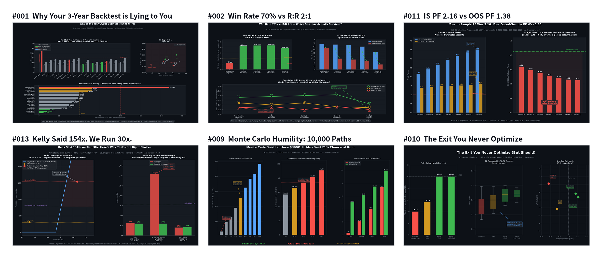
</picture>

- **켈리 공식은 154배라 했지만, 우리는 30배를 씁니다.** 개별 거래 기준 켈리는 10개 슬롯이 동시에 열릴 때 하프 켈리만 적용해도 자산의 770%가 위험에 노출된다는 사실을 간과합니다. → [#013](insights/post_013/post_013_kelly_leverage.md)
- **IS 수익 지수(PF) 2.16, OOS는 1.38.** 2020–22년에 최적화하고 2023–25년에 고정 검증한 7개 변형 전략 모두 36–55% 하락했으며, OOS/IS 0.85 기준을 통과한 것은 단 하나도 없었습니다. → [#011](insights/post_011/post_011_is_oos_divergence.md)
- **백테스트는 +$125, 실전은 −$33 — 같은 시그널, 같은 봉.** 장중 트레일링 체결 대 종가 기준 실행의 차이로, 단순 슬리피지가 아닌 모델링 가정의 문제입니다. → [#014](insights/post_014/post_014_mfe_exit_gap.md)

각 포스트는 핵심 발견, 차트, 차트를 생성한 스크립트, 그리고 링크드인용 요약문으로 완결성 있게 구성되어 있습니다. 측정 대상이 된 시스템은 [quantbox](https://github.com/younghwan91/quantbox)(오픈소스)입니다. 이 저장소는 *검증 방법론과 분석 기록*을 담고 있으며, 투자 실적을 과시하거나 해당 전략이 앞으로도 계속 작동할 것이라 주장하지 않습니다.

## 포스트 목록

| | 포스트 | 핵심 발견 |
|---|---|---|
| <a href="insights/post_001/post_001_3yr_vs_6yr_crash_test.md">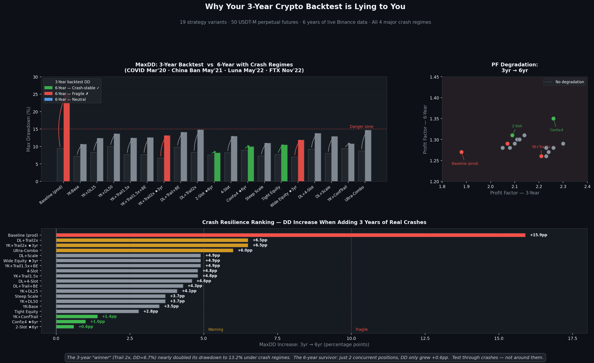</a> | **001 · [3년짜리 크립토 백테스트가 당신을 속이는 이유](insights/post_001/post_001_3yr_vs_6yr_crash_test.md)** 폭락 내성 | 코로나, 루나, FTX가 기간에 포함되자 3년 백테스트 1위 설정의 MaxDD가 6.7% → 13.2%로 치솟은 반면, 2-슬롯 설정은 +0.6pp 변화에 그쳤습니다. |
| <a href="insights/post_002/post_002_wr_vs_rr.md">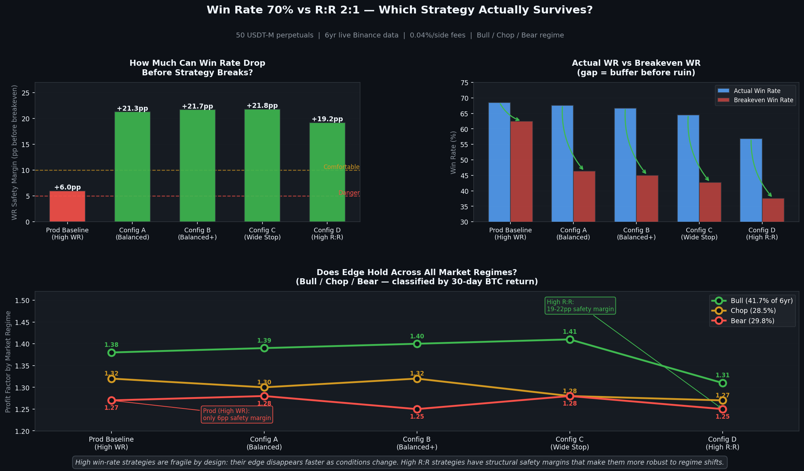</a> | **002 · [승률 70% vs 손익비 2:1 — 실제로 살아남는 것은?](insights/post_002/post_002_wr_vs_rr.md)** 위험 대비 보상 비율 | 68.5% 승률 기준선은 손익분기점 대비 여유가 6pp뿐이었지만, 균형 잡힌 손익비(1.16–1.22)는 상승·횡보·하락장 모두에서 21–22pp의 마진을 유지했습니다. |
| <a href="insights/post_003/post_003_long_short_reversal.md">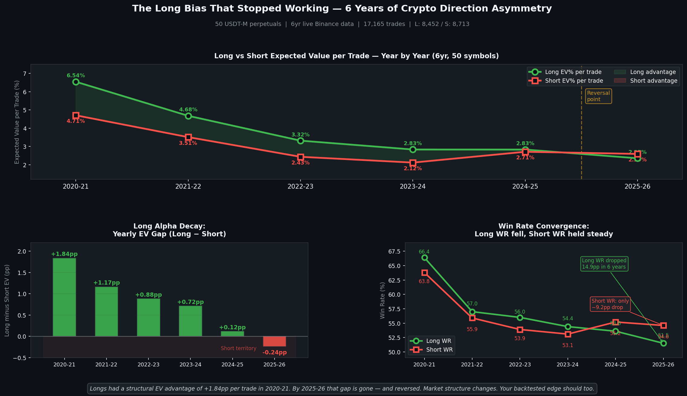</a> | **003 · [더 이상 통하지 않는 롱 편향](insights/post_003/post_003_long_short_reversal.md)** 방향성 우위 | 17,165건의 거래에 걸쳐 롱-숏 기댓값(EV) 격차가 매년 축소되어 +1.84pp(2020-21) → −0.24pp(2025-26)로 역전되었습니다. |
| <a href="insights/post_004/post_004_universe_expansion.md">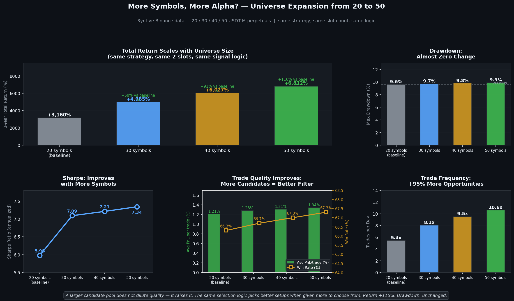</a> | **004 · [종목 수가 늘어나면 알파도 커질까?](insights/post_004/post_004_universe_expansion.md)** 유니버스 선정 | 심볼을 20개 → 50개로 늘리자 MaxDD는 거의 유지(단계당 +0.1pp)되면서 샤프 지수와 거래당 평균 PnL이 상승했으며, 대부분의 개선은 20 → 30개 구간에서 발생했습니다. |
| <a href="insights/post_005/post_005_slot_count_sweet_spot.md">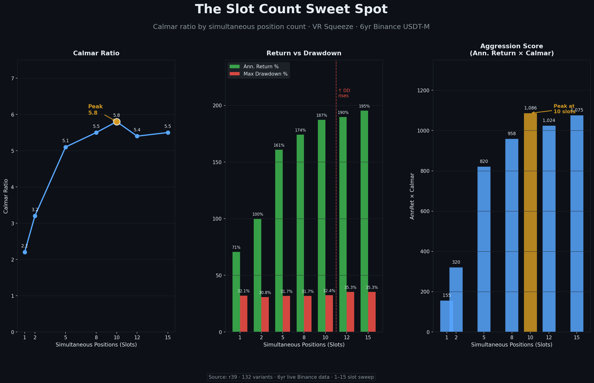</a> | **005 · [동시 보유 슬롯 수의 스위트 스팟](insights/post_005/post_005_slot_count_sweet_spot.md)** 포지션 사이징 | 칼마(Calmar) 비율은 동시 슬롯 10개에서 정점을 찍습니다. 12개 이상은 칼마 개선 없이 낙폭만 키우고 일일 거래 횟수도 10개 이후 포화됩니다. |
| <a href="insights/post_006/post_006_trailing_stop_already_good.md">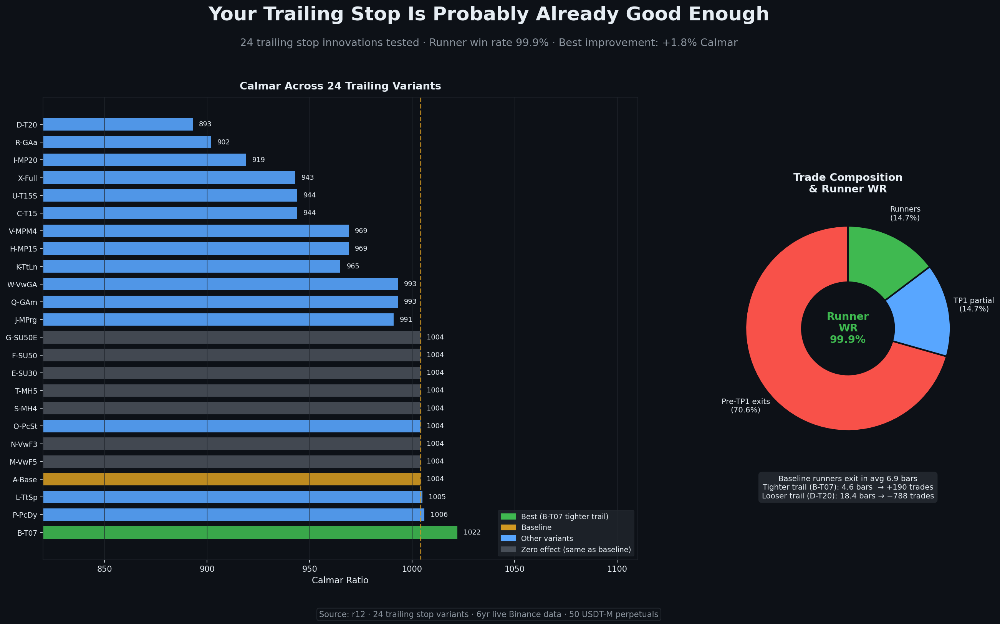</a> | **006 · [당신의 트레일링 스톱은 이미 충분히 좋을 수 있습니다](insights/post_006/post_006_trailing_stop_already_good.md)** 청산 메커니즘 | 24가지 트레일링 변형 실험: 계단식 상향, 최대 보유 기간, VWMA 하한선은 효과가 없었고(러너는 평균 6.9봉 내 청산), 더 타이트한 ATR 트레일만 칼마를 +1.8% 개선했습니다. |
| <a href="insights/post_007/post_007_dynamic_params_failed.md">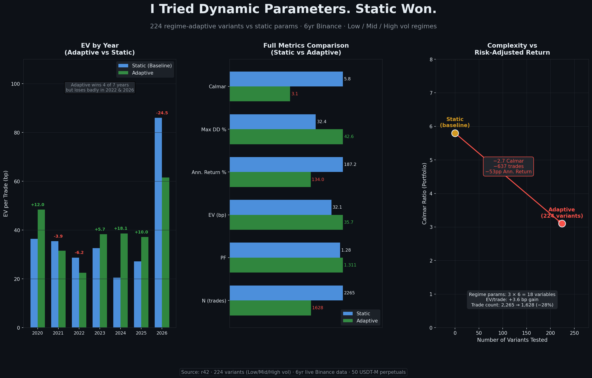</a> | **007 · [동적 파라미터를 시도해 봤습니다. 승자는 정적 파라미터였습니다.](insights/post_007/post_007_dynamic_params_failed.md)** 파라미터 강건성 | 국면 적응형 파라미터는 PF를 0.03 소폭 올렸지만 거래 횟수를 28% 줄이고 칼마를 5.8 → 3.1로 떨어뜨려 최종 채택하지 않았습니다. |
| <a href="insights/post_008/post_008_leverage_vs_slots.md">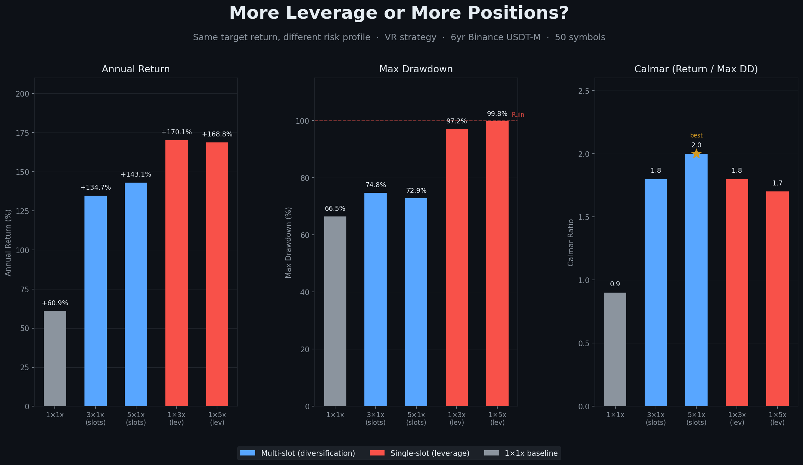</a> | **008 · [레버리지 확대 vs 포지션 분산?](insights/post_008/post_008_leverage_vs_slots.md)** 리스크 스케일링 | 5슬롯 × 1배와 1슬롯 × 5배는 수익률은 비슷하지만 MaxDD는 72.9% vs 99.8%로 갈립니다. 원인은 거래 간 PnL 상관계수 ρ = 0.051입니다. |
| <a href="insights/post_009/post_009_monte_carlo_humility.md">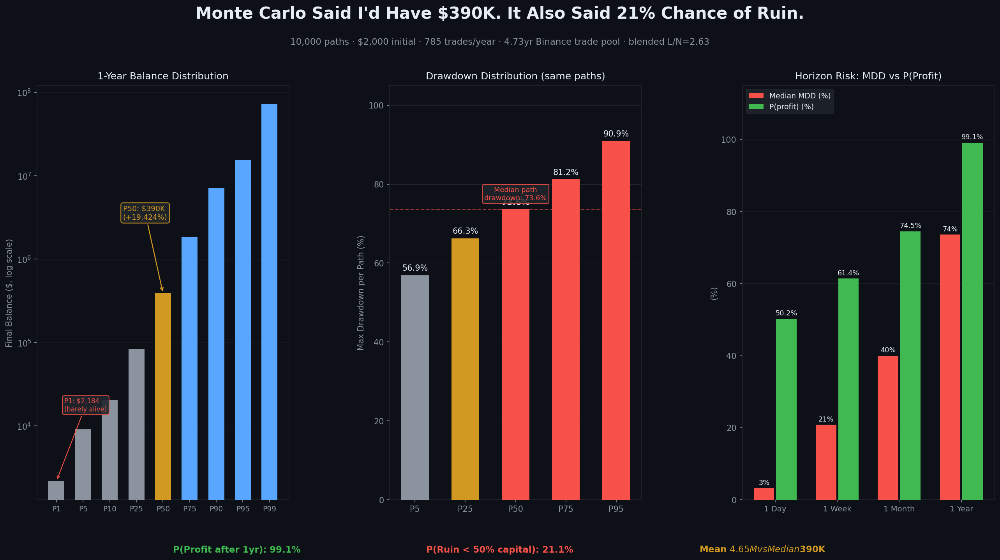</a> | **009 · [몬테카를로가 가르쳐준 겸손함](insights/post_009/post_009_monte_carlo_humility.md)** 낙폭 추정 | 10,000회 부트스트랩 경로 중 99.1%가 수익으로 끝났지만 *동시에* 중앙값 MaxDD는 73.6%에 달했으며, 평균 수익은 중앙값의 12배였습니다. |
| <a href="insights/post_010/post_010_exit_mode_beats_tpsl.md">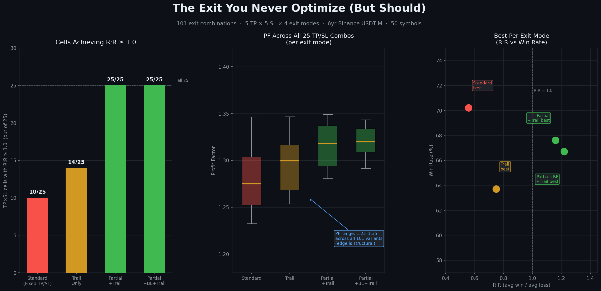</a> | **010 · [당신이 최적화하지 않는 청산 방식](insights/post_010/post_010_exit_mode_beats_tpsl.md)** 청산 전략 | 고정 TP/SL은 25개 그리드 중 10개만 손익비 ≥ 1을 달성한 반면, 분할 익절 + 트레일은 25개 전부가 달성했습니다. PF는 101개 변형 전체에서 1.23–1.35로 거의 움직이지 않았습니다. |
| <a href="insights/post_011/post_011_is_oos_divergence.md">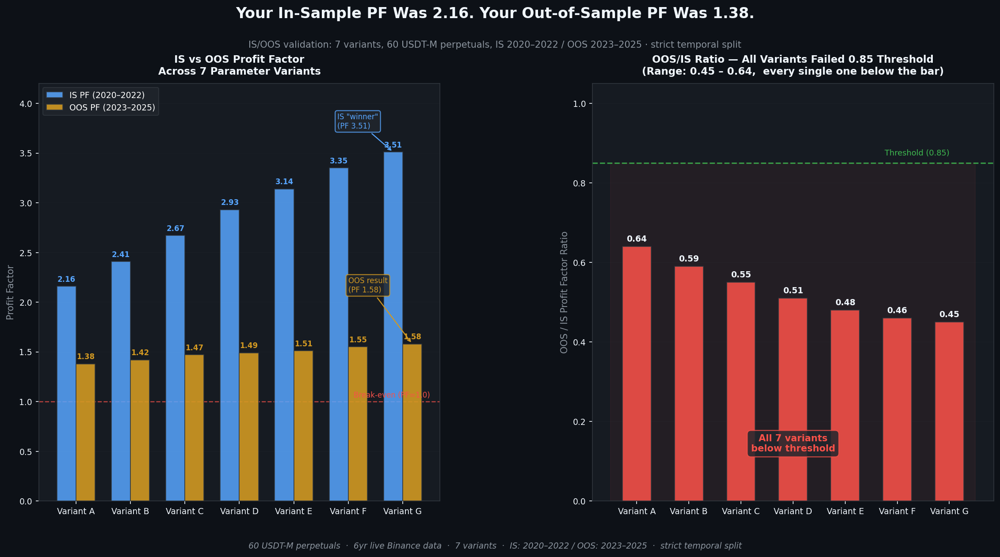</a> | **011 · [IS PF는 2.16이었는데, OOS PF는 1.38이었다](insights/post_011/post_011_is_oos_divergence.md)** 워크포워드 현실성 | 엄격한 시계열 분할 7개 변형 검증: OOS/IS 비율은 0.45–0.64로, 0.85 기준을 넘은 변형은 7개 중 0개였습니다. |
| <a href="insights/post_012/post_012_yearly_consistency.md">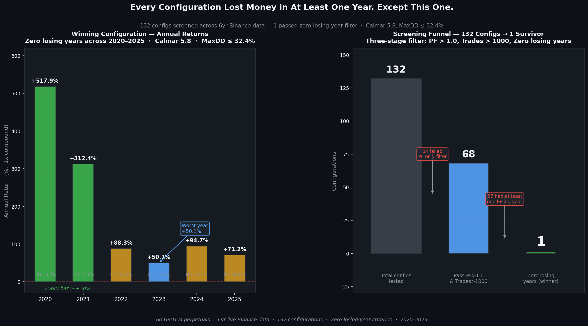</a> | **012 · [132개 설정을 테스트했다. 매년 수익을 낸 것은 단 1개뿐.](insights/post_012/post_012_yearly_consistency.md)** 연도별 일관성 | 132개 중 68개가 PF > 1 및 N > 1,000을 통과했지만 "2020–2025 무손실 연도" 조건을 추가하자 1개만 남았습니다. 2022년(루나, FTX)과 2023년(모멘텀 부재)이 핵심 필터였습니다. |
| <a href="insights/post_013/post_013_kelly_leverage.md">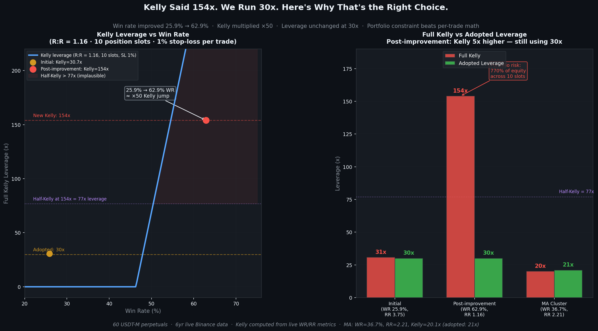</a> | **013 · [켈리는 154배라 했지만 우리는 30배를 쓴다. 그 이유는.](insights/post_013/post_013_kelly_leverage.md)** 포지션 사이징 | 승률이 25.9% → 62.9%로 오르며 풀 켈리가 약 5배(30.7배 → 154배) 뛰었지만, 켈리는 포트폴리오가 아니라 개별 거래 기준이므로 레버리지는 30배로 유지했습니다. |
| <a href="insights/post_014/post_014_mfe_exit_gap.md">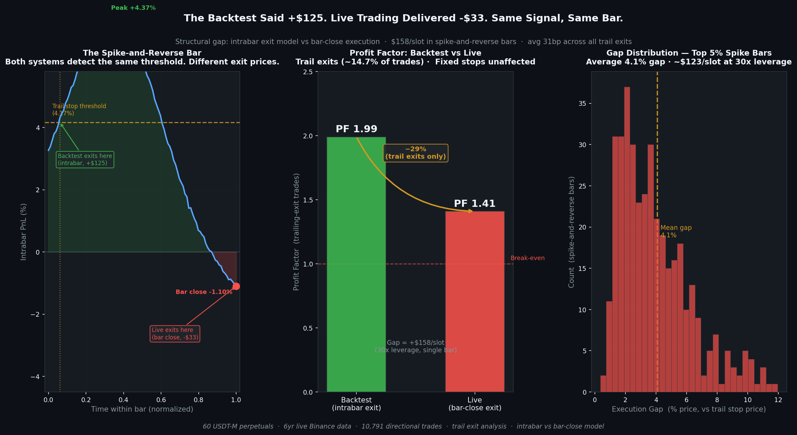</a> | **014 · [백테스트는 +$125, 실전은 -$33. 같은 시그널, 같은 봉.](insights/post_014/post_014_mfe_exit_gap.md)** 체결 모델 | 장중 트레일링 청산 vs 봉 마감 청산의 차이: 거래당 평균 31bp 격차가 발생했고, 트레일에 걸린 14.7%의 거래에서 PF가 1.99 → 1.41로 떨어졌습니다. |

**읽기 및 재현 방법.** 각 포스트의 `.md` 파일을 열어보세요. 옆에 있는 `.png`는 차트, `.txt`는 링크드인용 요약본이며, `.py` 스크립트는 본문의 수치를 바탕으로 matplotlib과 numpy만 사용해 차트를 다시 그립니다: `uv run --with matplotlib --with numpy python insights/post_011/post_011_is_oos_divergence.py`.

## 라이선스

MIT — 차트와 스크립트는 자유롭게 재사용할 수 있습니다. 단, 본 전략의 손익(P&L)을 본인의 백테스트 결과인 것처럼 주장하지 마세요.

## 토론 및 이슈

- 🐛 토론 및 질문 → [Issues](https://github.com/younghwan91/crypto-quant-insights/issues)
- 📈 업데이트 소식 → [Follow @younghwan91](https://github.com/younghwan91)

## 작성자

**Younghwan Chae** · [GitHub @younghwan91](https://github.com/younghwan91) · [LinkedIn](https://www.linkedin.com/in/younghwan-chae/)

전체 오픈소스 퀀트 스택은 [프로필](https://github.com/younghwan91)에서 확인할 수 있습니다.
