# Crypto Quant Insights 📈

Fourteen chart-backed lessons from validating a live Binance USDT-M futures system — what held up out-of-sample, what looked good and quietly wasn't, and why. The strategy stays private; the findings don't.

<picture>
  <source media="(prefers-color-scheme: dark)" srcset="docs/images/hero-dark.png">
  
</picture>

- **Kelly said 154x. We run 30x.** Per-trade Kelly ignores that ten open slots at half-Kelly would put 770% of equity at risk. → [#013](insights/post_013/post_013_kelly_leverage.md)
- **IS profit factor 2.16, OOS 1.38.** Seven variants optimized on 2020–22 and frozen for 2023–25: every one dropped 36–55%, none passed the 0.85 OOS/IS bar. → [#011](insights/post_011/post_011_is_oos_divergence.md)
- **Backtest said +$125, live delivered −$33, same signal, same bar.** Intrabar trail fills vs bar-close execution — a modeling assumption, not slippage. → [#014](insights/post_014/post_014_mfe_exit_gap.md)

Each post is self-contained: the finding, the chart, the script that drew it, and a LinkedIn-length version of the post. Signal logic and P&L are not here — the public infra these were measured on is [binance-quant-engine](https://github.com/younghwan91/binance-quant-engine). What's here is the *methodology and validation results*, not the alpha.

## Posts

| | Post | Finding |
|---|---|---|
| <a href="insights/post_001/post_001_3yr_vs_6yr_crash_test.md">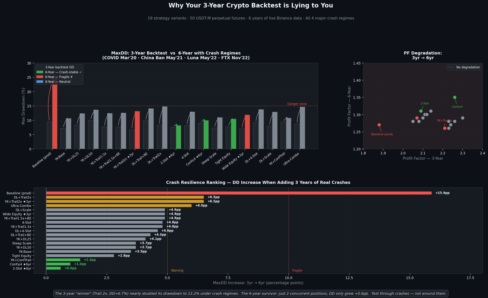</a> | **001 · [Why Your 3-Year Crypto Backtest is Lying to You](insights/post_001/post_001_3yr_vs_6yr_crash_test.md)** Crash resilience | The 3-year winner's MaxDD went 6.7% → 13.2% once COVID, Luna and FTX were in the window; the 2-slot config moved +0.6pp. |
| <a href="insights/post_002/post_002_wr_vs_rr.md">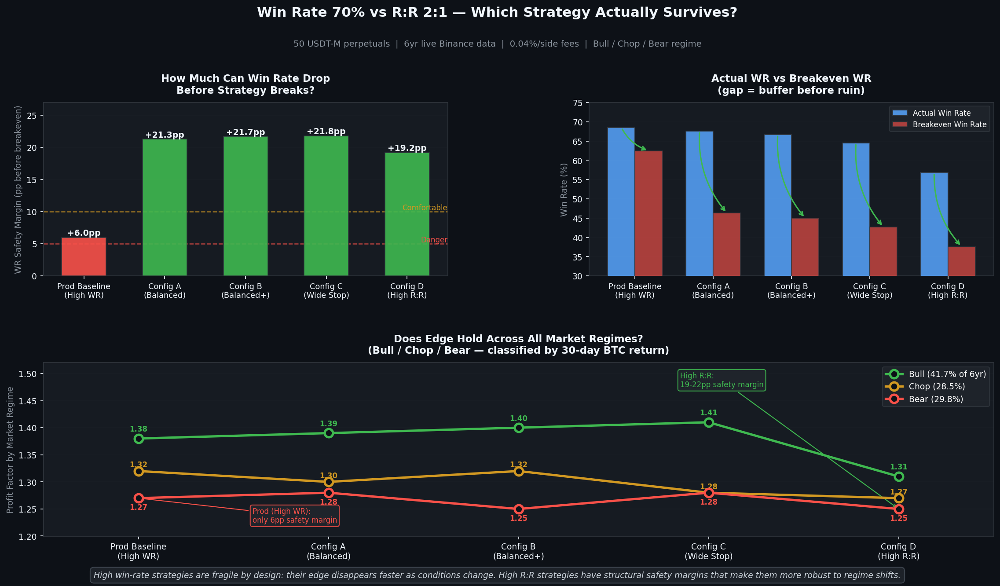</a> | **002 · [Win Rate 70% vs R:R 2:1 — Which Actually Survives?](insights/post_002/post_002_wr_vs_rr.md)** Risk-reward ratio | The 68.5%-WR baseline sat 6pp above its breakeven; balanced R:R (1.16–1.22) kept a 21–22pp margin across bull, chop and bear. |
| <a href="insights/post_003/post_003_long_short_reversal.md">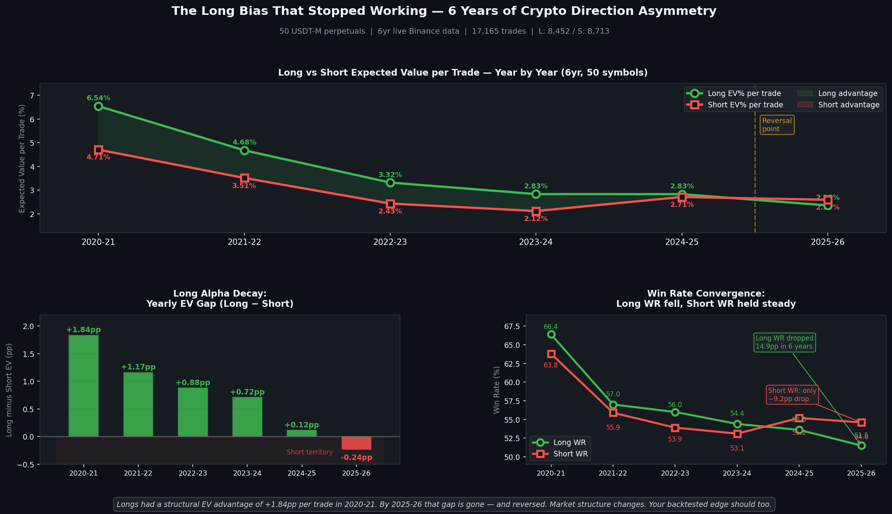</a> | **003 · [The Long Bias That Stopped Working](insights/post_003/post_003_long_short_reversal.md)** Directional edge | Long-minus-short EV gap shrank every year, +1.84pp (2020-21) → −0.24pp (2025-26), over 17,165 trades. |
| <a href="insights/post_004/post_004_universe_expansion.md">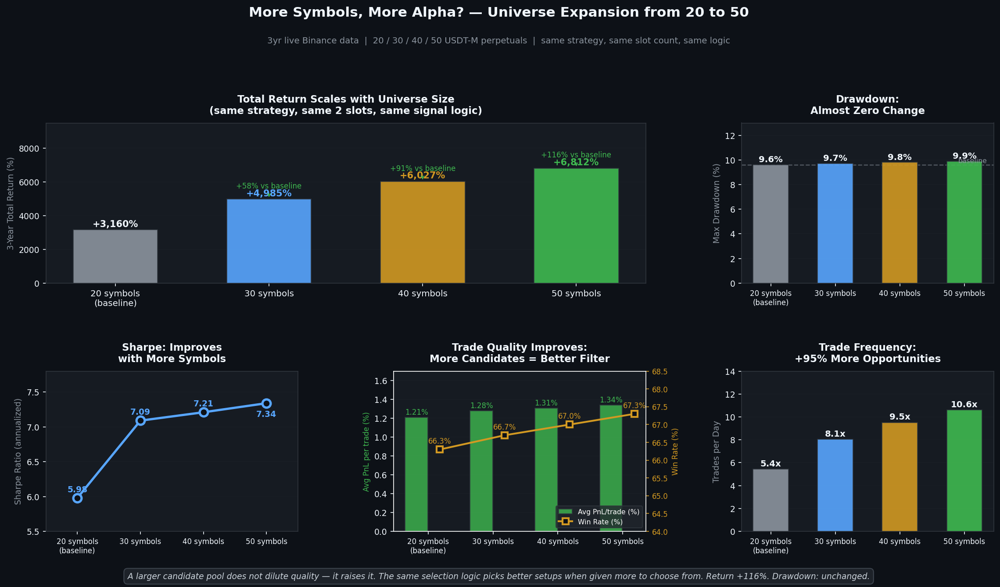</a> | **004 · [More Symbols, More Alpha?](insights/post_004/post_004_universe_expansion.md)** Universe selection | 20 → 50 symbols raised Sharpe and avg PnL per trade with MaxDD flat (+0.1pp per step); the 20 → 30 step gave most of it. |
| <a href="insights/post_005/post_005_slot_count_sweet_spot.md">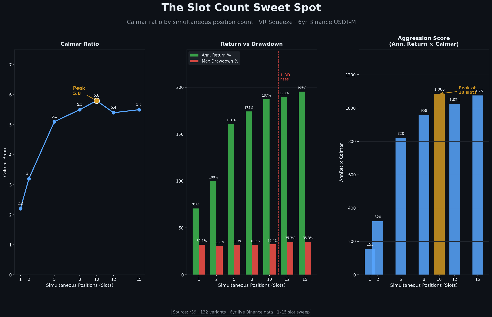</a> | **005 · [The Slot Count Sweet Spot](insights/post_005/post_005_slot_count_sweet_spot.md)** Position sizing | Calmar peaks at 10 concurrent slots; 12+ adds drawdown without a Calmar gain, and trades/day saturate past 10. |
| <a href="insights/post_006/post_006_trailing_stop_already_good.md">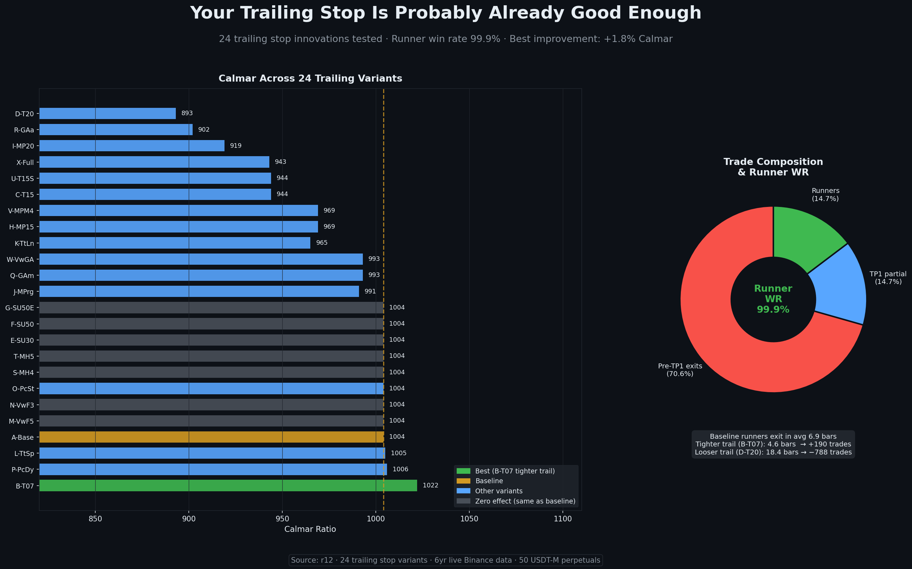</a> | **006 · [Your Trailing Stop Is Probably Already Good Enough](insights/post_006/post_006_trailing_stop_already_good.md)** Exit mechanics | 24 trailing variants: step-ups, max-hold and VWMA floors changed nothing (runners exit in 6.9 bars); only a tighter ATR trail moved Calmar, by +1.8%. |
| <a href="insights/post_007/post_007_dynamic_params_failed.md">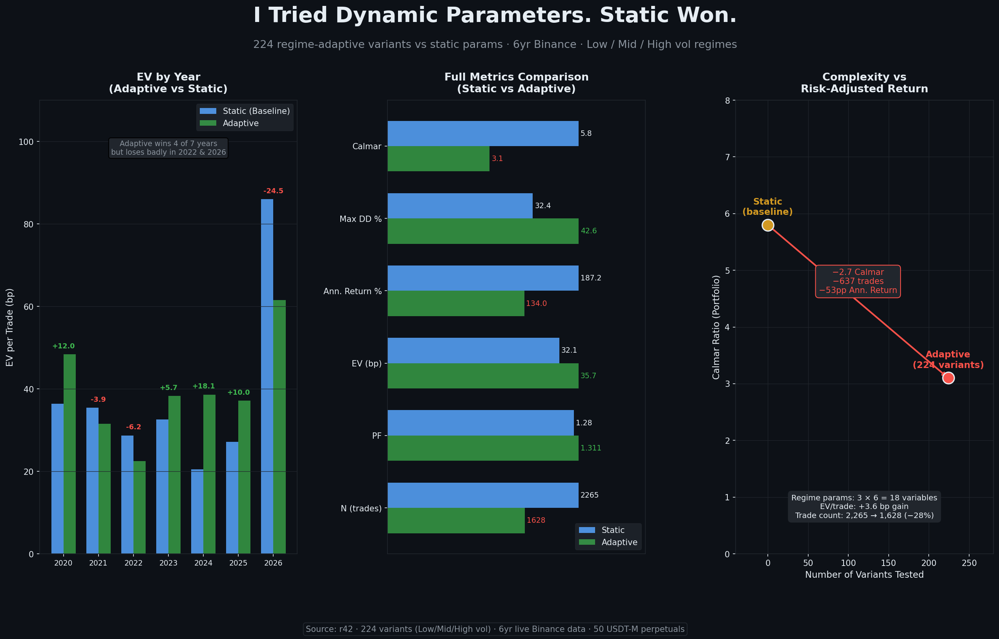</a> | **007 · [I Tried Dynamic Parameters. Static Won.](insights/post_007/post_007_dynamic_params_failed.md)** Parameter robustness | Regime-adaptive params nudged PF up 0.03 but cut trades 28% and took Calmar 5.8 → 3.1 — not implemented. |
| <a href="insights/post_008/post_008_leverage_vs_slots.md">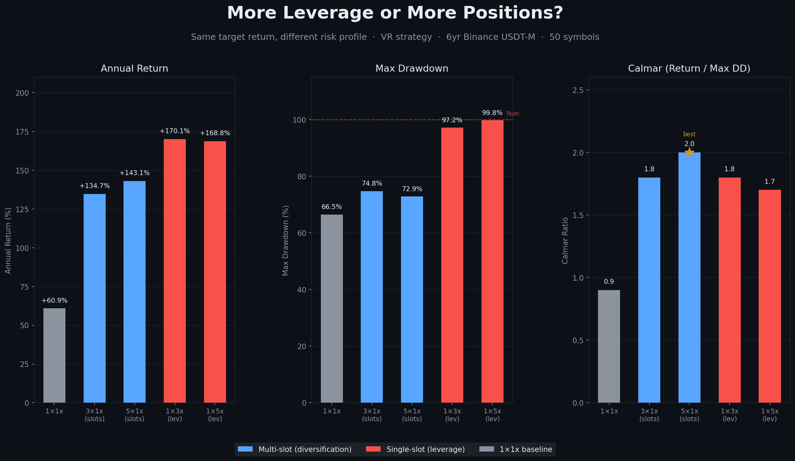</a> | **008 · [More Leverage or More Positions?](insights/post_008/post_008_leverage_vs_slots.md)** Risk scaling | 5 slots × 1x and 1 slot × 5x land on similar returns; MaxDD is 72.9% vs 99.8%. Cross-trade PnL correlation ρ = 0.051 is why. |
| <a href="insights/post_009/post_009_monte_carlo_humility.md">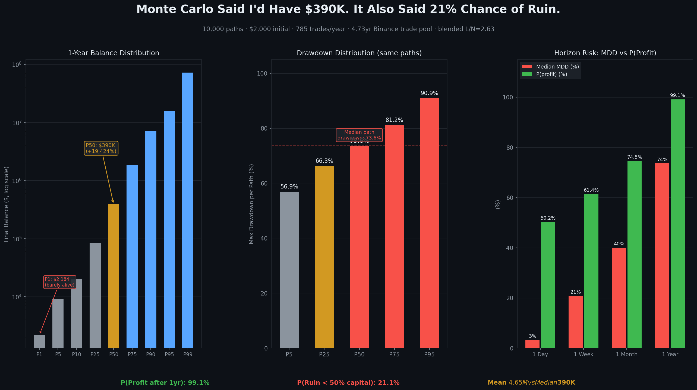</a> | **009 · [Monte Carlo Humility](insights/post_009/post_009_monte_carlo_humility.md)** Drawdown estimation | 10,000 bootstrap paths: 99.1% end profitable *and* the median MaxDD is 73.6%; mean outcome is 12× the median. |
| <a href="insights/post_010/post_010_exit_mode_beats_tpsl.md">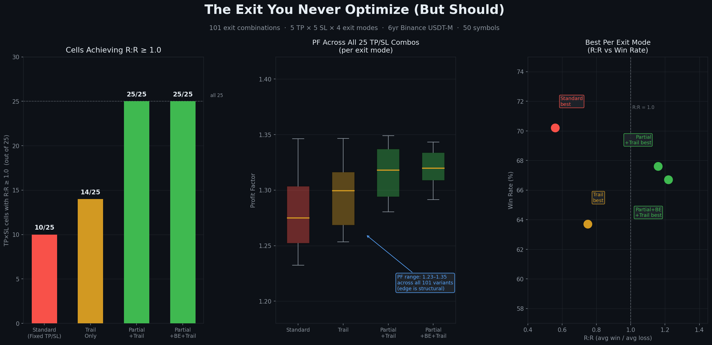</a> | **010 · [The Exit You Never Optimize](insights/post_010/post_010_exit_mode_beats_tpsl.md)** Exit strategy | Fixed TP/SL: 10 of 25 grid cells reach R:R ≥ 1. Partial + trail: 25 of 25. PF barely moves (1.23–1.35 across 101 variants). |
| <a href="insights/post_011/post_011_is_oos_divergence.md">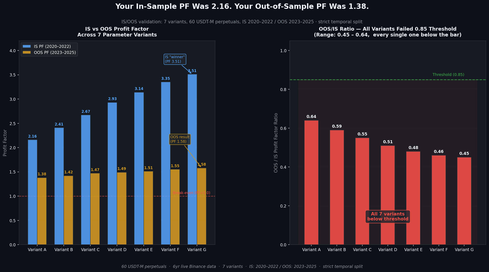</a> | **011 · [Your IS PF Was 2.16. Your OOS PF Was 1.38.](insights/post_011/post_011_is_oos_divergence.md)** Walk-forward realism | Strict temporal split, 7 variants: OOS/IS ratio 0.45–0.64, 0 of 7 above the 0.85 threshold. |
| <a href="insights/post_012/post_012_yearly_consistency.md">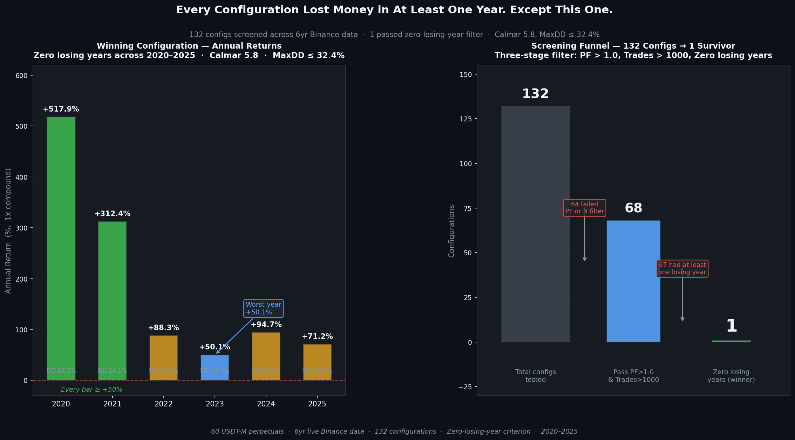</a> | **012 · [132 Configs Tested. Only 1 Was Profitable Every Single Year.](insights/post_012/post_012_yearly_consistency.md)** Cross-year consistency | 68 of 132 pass PF > 1 and N > 1,000; add "no losing year 2020–2025" and 1 survives. 2022 (Luna, FTX) and 2023 (no momentum) do the filtering. |
| <a href="insights/post_013/post_013_kelly_leverage.md">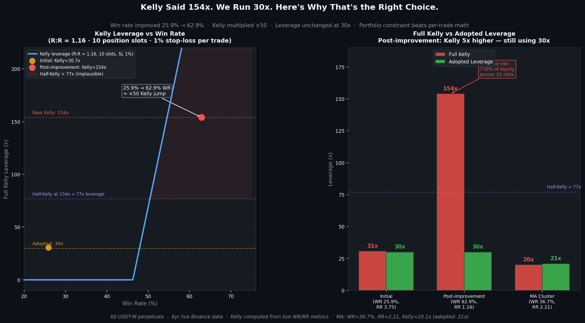</a> | **013 · [Kelly Said 154x. We Run 30x. Here's Why.](insights/post_013/post_013_kelly_leverage.md)** Position sizing | WR 25.9% → 62.9% multiplied full Kelly ~5× (30.7x → 154x); leverage stayed at 30x because Kelly is per-trade, not per-portfolio. |
| <a href="insights/post_014/post_014_mfe_exit_gap.md">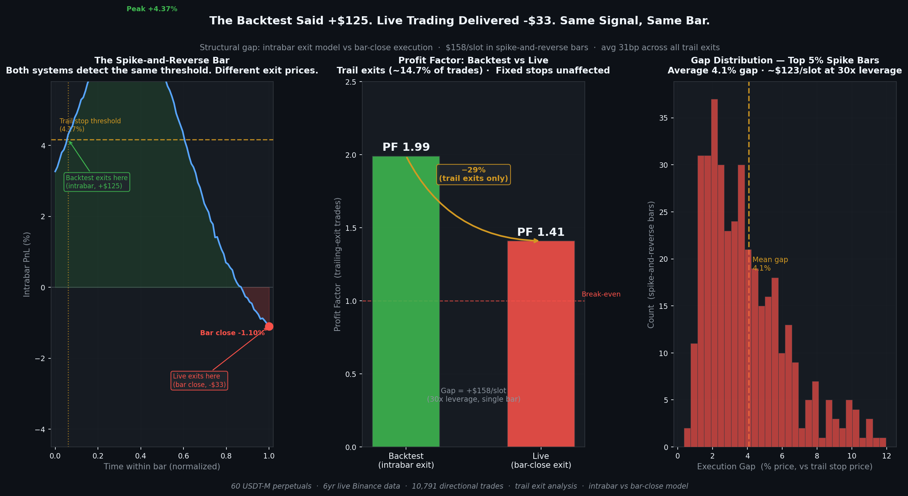</a> | **014 · [Backtest Said +$125. Live Delivered -$33. Same Signal, Same Bar.](insights/post_014/post_014_mfe_exit_gap.md)** Execution model | Intrabar vs bar-close trail exits: 31bp per trade on average, PF 1.99 → 1.41 on the 14.7% of trades that hit the trail. |

**How to read / reproduce.** Open a post's `.md`; the `.png` next to it is the chart, the `.txt` is the LinkedIn-length version of the post, and the `.py` redraws the chart from the numbers in the write-up with only matplotlib and numpy: `uv run --with matplotlib --with numpy python insights/post_011/post_011_is_oos_divergence.py`.

## License

MIT — reuse the charts/scripts, just don't claim the strategy P&L as your own backtest.

## Discussions & Issues

- 🐛 Discussions & questions → [Issues](https://github.com/younghwan91/crypto-quant-insights/issues)
- 📈 Updates → [Follow @younghwan91](https://github.com/younghwan91)

## Related projects — open-source quant stack

Part of an open-source stack spanning Korean equities, US equities and crypto. Each repository stands on its own.

| Market | Project | What it is |
|---|---|---|
| 🇰🇷 Korean equities | **[kiwoom-client](https://github.com/younghwan91/kiwoom-client)** | Kiwoom Securities REST API client — full domestic-equity endpoint coverage, real-time WebSocket, sync + async (`pip install kiwoom-client`) |
| 🇰🇷 Korean equities | **[krx-fundamentals-client](https://github.com/younghwan91/krx-fundamentals-client)** | Korean corporate fundamentals Python client library — financial statements, valuation, dividends, screening (DART + KRX + Naver) |
| 🇰🇷 Korean equities | **[krx-news-client](https://github.com/younghwan91/krx-news-client)** | Korean market news & disclosures as one schema — Python client library (DART + Toss Securities) |
| 🇰🇷 Korean equities | **[krx-quant-core](https://github.com/younghwan91/krx-quant-core)** | Shared Python core for Korean-equity quant systems — KRX tick, price-limit and session rules, date-aware transaction-tax cost model, Kiwoom order guards, DART material-disclosure risk classification, fill simulation, Deflated Sharpe and purged CV stats |
| 🇰🇷 Korean equities | **[fin-checkup](https://github.com/younghwan91/fin-checkup)** | Telegram alerts for risk disclosures + a DART/SEC financial health checkup — reports measurements and facts, never a recommendation |
| 🇰🇷 Korean equities | **[quant-airflow](https://github.com/younghwan91/quant-airflow)** | Airflow pipeline collecting Korean market data into TimescaleDB — delisted names included, so downstream backtests aren't survivorship-biased |
| 🇰🇷 Korean equities | **[swing-it](https://github.com/younghwan91/swing-it)** | KOSPI/KOSDAQ alpha validation framework — judged on the per-trade distribution, with random null controls, purged CV and Deflated Sharpe enforced as CI guardrails |
| 🇺🇸 US equities | **[portfolio-research](https://github.com/younghwan91/portfolio-research)** | US equity factor engine — walk-forward gated by Deflated Sharpe and PBO on point-in-time, survivorship-bias-free data; tactical ETF allocation goes through the same gate |
| 🇺🇸 US equities | **[macro-sector-agent](https://github.com/younghwan91/macro-sector-agent)** | Top-down US sector-cycle research — asks which industry has been forgotten, not what to buy; the machine excludes, never picks |
| 🇺🇸 US equities | **[automated-stock-trading-systems](https://github.com/younghwan91/automated-stock-trading-systems)** | Backtester for Bensdorp's seven non-correlated trading systems (educational reimplementation) |
| ₿ Crypto | **[binance-quant-engine](https://github.com/younghwan91/binance-quant-engine)** | Crypto futures backtest & execution engine — zero lookahead, backtest↔live parity |

## Author

**Younghwan Chae** · [GitHub @younghwan91](https://github.com/younghwan91) · [LinkedIn](https://www.linkedin.com/in/younghwan-chae/)

See the full open-source quant stack on my [profile](https://github.com/younghwan91).
