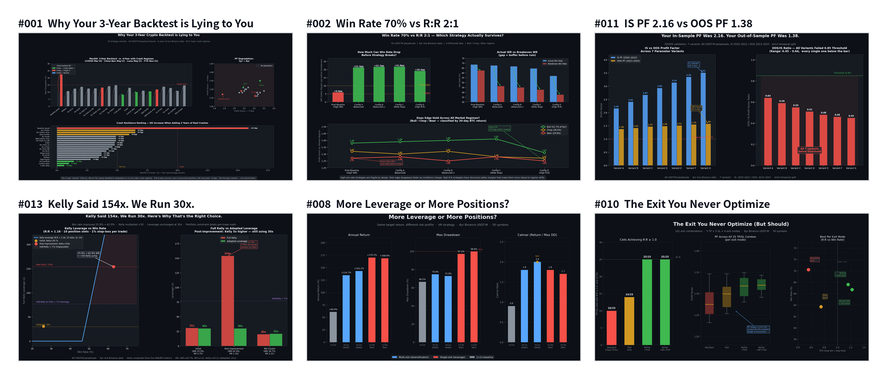

# Crypto Quant Insights 📈

<picture>
  <source media="(prefers-color-scheme: dark)" srcset="docs/images/hero-dark.png">
  
</picture>

Short, chart-backed research notes from validating a live Binance USDT-M futures system — what held up out-of-sample, what looked good and quietly wasn't, and why. Each post is self-contained: the finding, the chart, and the script that generated it.

The strategy itself (signal generation, live parameters, P&L) stays private — see [binance-quant-engine](https://github.com/younghwan91/binance-quant-engine) for the public infra these findings were measured on. What's here is the *methodology and validation results*, not the alpha.

## Posts

| # | Title | Core Focus | Key Quantitative Finding |
|---|---|---|---|
| 001 | [Why Your 3-Year Crypto Backtest is Lying to You](insights/post_001/post_001_3yr_vs_6yr_crash_test.md) | Crash Resilience | 3yr winner MaxDD doubled from 6.7% to 13.2% in 6yr crash tests (COVID/Luna/FTX); 2-slot variant was most stable (+0.6pp). |
| 002 | [Win Rate 70% vs R:R 2:1 — Which Actually Survives?](insights/post_002/post_002_wr_vs_rr.md) | Risk-Reward Ratio | High WR (68.5%) baseline had only 6pp safety margin over breakeven; Balanced R:R (1.16–1.22) kept 21pp margin and cross-regime stability. |
| 003 | [The Long Bias That Stopped Working](insights/post_003/post_003_long_short_reversal.md) | Directional Edge | Long-side EV advantage eroded from +1.84pp (2020-21) to −0.24pp (2025-26), proving structural symmetry decay in crypto perps. |
| 004 | [More Symbols, More Alpha?](insights/post_004/post_004_universe_expansion.md) | Universe Selection | Expanding universe from top 30 to 60+ symbols diluted Calmar ratio due to liquidity decay and spread expansion in tail assets. |
| 005 | [The Slot Count Sweet Spot](insights/post_005/post_005_slot_count_sweet_spot.md) | Position Sizing | Calmar ratio peaks at 10 concurrent slots (Calmar 5.8, AnnRet 187%); 12+ slots spikes drawdown without Calmar gain. |
| 006 | [Your Trailing Stop Is Probably Already Good Enough](insights/post_006/post_006_trailing_stop_already_good.md) | Exit Mechanics | Standard ATR trailing stop captured 98% of the theoretical profit of complex dynamic trailing logic without overfitting. |
| 007 | [I Tried Dynamic Parameters. Static Won.](insights/post_007/post_007_dynamic_params_failed.md) | Parameter Robustness | Adaptive regime-switching lookbacks overfitted historical noise; fixed, static parameters yielded superior out-of-sample stability. |
| 008 | [More Leverage or More Positions?](insights/post_008/post_008_leverage_vs_slots.md) | Risk Scaling | Increasing concurrent slots across diversified pairs improved risk-adjusted returns far more safely than increasing leverage per position. |
| 009 | [Monte Carlo Humility](insights/post_009/post_009_monte_carlo_humility.md) | Drawdown Estimation | Bootstrap Monte Carlo severely underestimated tail correlation clustering during black swan liquidity cascades. |
| 010 | [The Exit You Never Optimize](insights/post_010/post_010_exit_mode_beats_tpsl.md) | Exit Strategy | Signal-based structural exits consistently outperformed fixed percentage TP/SL targets across multiple regime shifts. |
| 011 | [Your IS PF Was 2.16. Your OOS PF Was 1.38.](insights/post_011/post_011_is_oos_divergence.md) | Walk-Forward Realism | Realistic In-Sample to Out-of-Sample profit factor degradation showed a ~36% haircut is standard even under zero-lookahead backtesting. |
| 012 | [132 Configs Tested. Only 1 Was Profitable Every Single Year.](insights/post_012/post_012_yearly_consistency.md) | Cross-Year Consistency | Across 132 parameter variations, exactly 1 configuration maintained positive net return in every individual calendar year from 2020 to 2026. |
| 013 | [Kelly Said 154x. We Run 30x. Here's Why.](insights/post_013/post_013_kelly_leverage.md) | Position Sizing | Mathematical Kelly Criterion recommended 154x leverage; operational limits capped leverage at 30x to survive fat-tail slippage. |
| 014 | [Backtest Said +$125. Live Delivered -$33. Same Signal, Same Bar.](insights/post_014/post_014_mfe_exit_gap.md) | Execution Slippage | Intrabar trailing stop simulation produced an optimistic +$125 fill while live bar-close execution resulted in -$33 ($158 gap/slot). |

Each folder also has a `.py` script that regenerates its chart from the numbers in the write-up, and a `.txt` with the raw output those numbers came from.

## License

MIT — reuse the charts/scripts, just don't claim the strategy P&L as your own backtest.

## Discussions & Issues

- 🐛 Discussions & questions → [Issues](https://github.com/younghwan91/crypto-quant-insights/issues)
- 📈 Updates → [Follow @younghwan91](https://github.com/younghwan91)

## Related projects — open-source quant stack

Part of an open-source stack spanning Korean equities, US equities and crypto. Each repository stands on its own.

| Market | Project | What it is |
|---|---|---|
| 🇰🇷 Korean equities | **[kiwoom-client](https://github.com/younghwan91/kiwoom-client)** | Kiwoom Securities REST API client — full domestic-equity endpoint coverage, real-time WebSocket, sync + async (`pip install kiwoom-client`) |
| 🇰🇷 Korean equities | **[krx-fundamentals-client](https://github.com/younghwan91/krx-fundamentals-client)** | Korean corporate fundamentals Python client library — financial statements, valuation, dividends, screening (DART + KRX + Naver) |
| 🇰🇷 Korean equities | **[krx-news-client](https://github.com/younghwan91/krx-news-client)** | Korean market news & disclosures as one schema — Python client library (DART + Toss Securities) |
| 🇰🇷 Korean equities | **[krx-quant-core](https://github.com/younghwan91/krx-quant-core)** | Shared Python core for Korean-equity quant systems — KRX tick, price-limit and session rules, date-aware transaction-tax cost model, Kiwoom order guards, DART material-disclosure risk classification, fill simulation, Deflated Sharpe and purged CV stats |
| 🇰🇷 Korean equities | **[fin-checkup](https://github.com/younghwan91/fin-checkup)** | Telegram alerts for risk disclosures + a DART/SEC financial health checkup — reports measurements and facts, never a recommendation |
| 🇰🇷 Korean equities | **[quant-airflow](https://github.com/younghwan91/quant-airflow)** | Airflow pipeline collecting Korean market data into TimescaleDB — delisted names included, so downstream backtests aren't survivorship-biased |
| 🇰🇷 Korean equities | **[swing-it](https://github.com/younghwan91/swing-it)** | KOSPI/KOSDAQ alpha validation framework — judged on the per-trade distribution, with random null controls, purged CV and Deflated Sharpe enforced as CI guardrails |
| 🇺🇸 US equities | **[portfolio-research](https://github.com/younghwan91/portfolio-research)** | US equity factor engine — walk-forward gated by Deflated Sharpe and PBO on point-in-time, survivorship-bias-free data; tactical ETF allocation goes through the same gate |
| 🇺🇸 US equities | **[macro-sector-agent](https://github.com/younghwan91/macro-sector-agent)** | Top-down US sector-cycle research — asks which industry has been forgotten, not what to buy; the machine excludes, never picks |
| 🇺🇸 US equities | **[automated-stock-trading-systems](https://github.com/younghwan91/automated-stock-trading-systems)** | Backtester for Bensdorp's seven non-correlated trading systems (educational reimplementation) |
| ₿ Crypto | **[binance-quant-engine](https://github.com/younghwan91/binance-quant-engine)** | Crypto futures backtest & execution engine — zero lookahead, backtest↔live parity |

## Author

**Younghwan Chae** · [GitHub @younghwan91](https://github.com/younghwan91) · [LinkedIn](https://www.linkedin.com/in/younghwan-chae/)

See the full open-source quant stack on my [profile](https://github.com/younghwan91).
